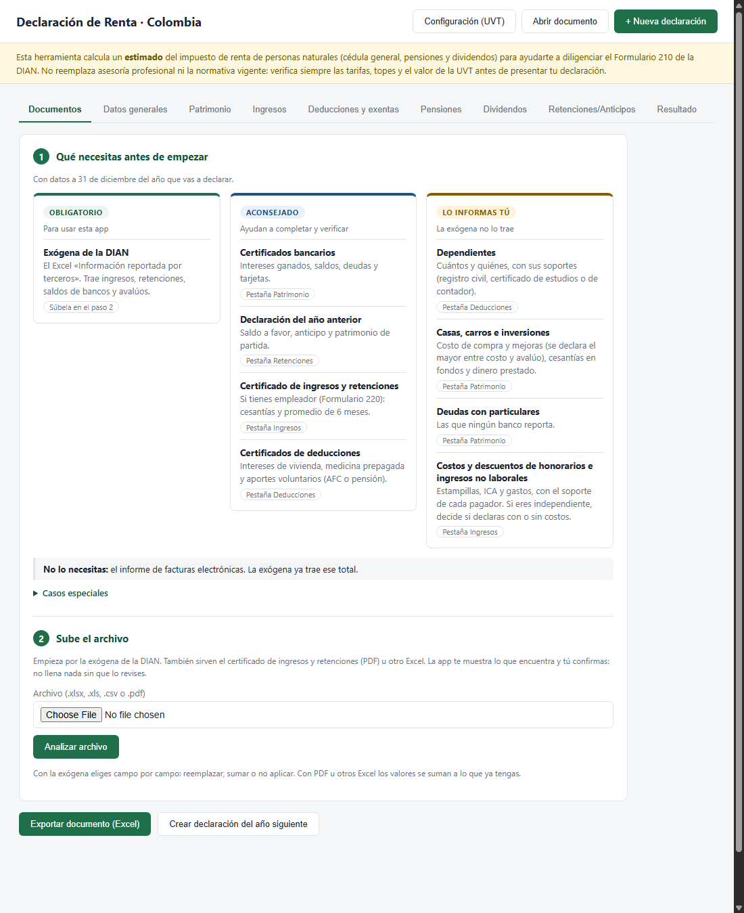
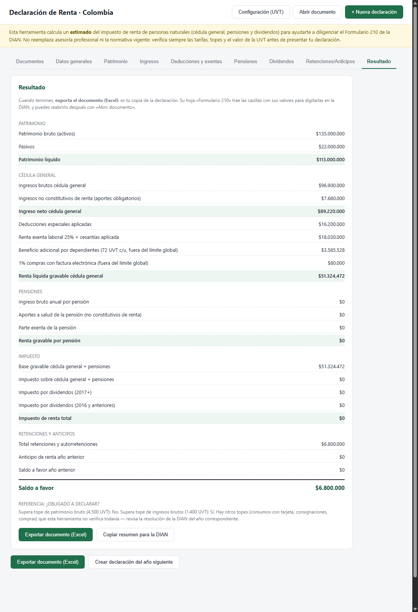

# Declaración de Renta · Colombia

*A free, offline, privacy-first web app to estimate Colombian personal income tax and prepare the DIAN's Formulario 210.*

Calculadora de apoyo para **personas naturales residentes en Colombia**. Toma la información que la DIAN
ya tiene sobre ti (la «exógena»), te ayuda a completar lo que falta, calcula el impuesto de renta y te
entrega las **casillas del Formulario 210** listas para digitar en la DIAN.

> **Importante:** es un **estimado**, no asesoría tributaria. Verifica siempre el resultado con un
> contador o directamente en el formulario de la DIAN antes de presentar tu declaración.



## Qué hace

- **Funciona sin internet y sin instalar nada.** Se abre con doble clic en `index.html`.
- **No guarda tus datos.** Lo que conservas es un documento Excel que tú exportas.
- **Importa la exógena de la DIAN** y propone el valor de cada campo (ingresos, retenciones, saldos de
  bancos, deudas, saldo a favor del año anterior...). Tú revisas y confirmas; nunca llena nada sola.
- **Te dice si estás obligado a declarar**, con los cinco topes de la DIAN.
- **Calcula el impuesto** de la cédula general, de pensiones y de dividendos, con deducciones, rentas
  exentas y beneficios, incluido el caso de **independientes** (con o sin costos).
- **Entrega las casillas del Formulario 210** con los números y nombres oficiales, y te dice cuáles
  digitas tú y cuáles calcula la DIAN.
- **Encadena los años:** crea la declaración del año siguiente con lo que persiste (patrimonio, saldo a
  favor, dependientes).

**Lo que no hace:** no presenta ni envía la declaración. Tienes que digitar los valores en el formulario
de la DIAN con tu propia cuenta. Tampoco reemplaza a un contador en casos complejos (ver
[Qué no calcula](#qué-no-calcula)).

## Cómo empezar

### Requisitos

Un navegador moderno (probada con Google Chrome). No necesitas internet, servidor, Node ni instalación.

### Descargar

- **Sin Git:** en GitHub pulsa **Code → Download ZIP**, descomprime la carpeta (en Windows: clic
  derecho → *Extraer todo*; no la abras desde dentro del ZIP) y abre `index.html`.
- **Con Git:** `git clone https://github.com/jsowl044/calculadora-declaracion-renta.git` y, para actualizar más
  adelante, `git pull`.

La carpeta es portable: puedes copiarla a una USB y abrirla en otro equipo. Al pie de la página aparece
la **versión**, útil para confirmar que usas la copia actualizada.

## Cómo usarla, paso a paso

1. **Descarga tu exógena.** En el portal de la DIAN, con tu cuenta, consulta la información exógena
   («Información reportada por terceros») del año que vas a declarar y descarga el Excel.
2. **Súbela en la pestaña *Documentos*.** Elige el archivo y pulsa **Analizar archivo**.
3. **Revisa lo que encontró.** Para cada campo verás el valor de la DIAN y eliges **Reemplazar**,
   **Sumar** o **No aplicar**; luego pulsa **Aplicar al formulario**. La app también compara tus ingresos
   con el «Tope 1» de la DIAN y avisa si te falta incluir algo. Arriba del panel verás si, con los topes de
   tu exógena, estás obligado a declarar.
4. **Completa lo que la exógena no trae** en las demás pestañas: dependientes, deducciones, patrimonio
   no reportado, costos de ingresos no laborales. Si eres independiente, decide si declaras tus honorarios
   con o sin costos (ver [Qué necesitas reunir](#qué-necesitas-reunir)).
5. **Mira la pestaña *Resultado*:** impuesto, saldo a pagar o a favor, si estás obligado a declarar y avisos.
6. **Exporta el documento** con **Exportar documento (Excel)**. Es tu copia de la declaración: la hoja
   «Formulario 210» trae las casillas y la hoja «Datos» permite reabrirla después.
7. **Digita las casillas en el formulario de la DIAN.** El botón **Copiar resumen para la DIAN** deja los
   valores en un texto listo para consultar mientras llenas el formulario.

Para seguir trabajando otro día usa **Abrir documento**. Para el año siguiente, abre el documento y
pulsa **Crear declaración del año siguiente**.



*La captura usa datos inventados.*

## Qué necesitas reunir

La primera pestaña de la app trae esta misma guía.

| Qué | Prioridad | Para qué |
|---|---|---|
| Exógena de la DIAN | **Obligatorio** para usar la app | Ingresos, retenciones, saldos de bancos y avalúos |
| Certificados bancarios | Aconsejado | Intereses ganados, saldos y deudas |
| Declaración del año anterior | Aconsejado | Saldo a favor, anticipo y patrimonio de partida |
| Certificado de ingresos y retenciones (Formulario 220) | Aconsejado, si tienes empleador | Cesantías y promedio de 6 meses |
| Certificados de deducciones | Si los tienes | Intereses de vivienda, medicina prepagada, aportes voluntarios (AFC o pensión) |
| Dependientes | **Lo informas tú** | Reducen la base; necesitan soporte |
| Casas, carros, inversiones | **Lo informas tú** | Costo de compra y mejoras, cesantías en fondos, dinero prestado |
| Deudas con particulares | **Lo informas tú** | Las que ningún banco reporta |
| Costos y descuentos de honorarios e ingresos no laborales | **Lo informas tú** | Con el soporte de cada pagador; si eres independiente, decide si declaras con o sin costos |
| Informe de facturas electrónicas | No hace falta | La exógena ya trae ese total |

La exógena solo contiene lo que reportan terceros. La propia DIAN advierte en el archivo que no es
indispensable y que no reemplaza tu conocimiento de tu situación económica.

## Qué calcula

- **Cédula general:** rentas de trabajo, de capital y no laborales, con sus ingresos no constitutivos de
  renta y sus costos y deducciones procedentes.
- **Independientes** (honorarios y servicios sin relación laboral), con las dos opciones que exige el
  instructivo de la DIAN: **sin costos**, con la renta exenta del 25% (casillas 32 y 356), o **con costos y
  gastos** en su propia columna (casillas 43 a 57), sin esa renta exenta. Las deducciones se reparten entre las
  dos columnas dentro de un único cupo del 40%.
- **Deducciones y rentas exentas:** intereses de vivienda, medicina prepagada, dependientes, aportes
  voluntarios (AFC/AVC), renta exenta laboral del 25% y cesantías, con el límite global del 40% y 1.340 UVT.
- **Beneficios fuera de ese límite:** 72 UVT adicionales por dependiente (hasta 4) y el 1% de las compras
  con factura electrónica (tope 240 UVT). Sin relación laboral, cada dependiente da la deducción del 10% **o**
  los 72 UVT, no ambas: la app elige la combinación que deja menos impuesto y te lo explica.
- **Pensiones**, con la exención de las primeras 1.000 UVT mensuales.
- **Impuesto** con la tabla progresiva del Art. 241 del Estatuto Tributario; **dividendos** por el
  Art. 242.
- **Retenciones, anticipo y saldo a favor del año anterior**, hasta llegar al saldo a pagar o a favor.
- **¿Estás obligado a declarar?** Revisa los cinco topes de los Arts. 592 y 594-3 del Estatuto Tributario
  (patrimonio, ingresos, consumos con tarjeta, compras y consignaciones). Los tres últimos los trae la exógena.

Las reglas corresponden al año gravable 2023 en adelante (Ley 2277 de 2022).

## Qué no calcula

- Ganancias ocasionales.
- El anticipo del impuesto para el año siguiente (casilla 133).
- Descuentos tributarios, como el de donaciones.
- Renta presuntiva ni compensación de pérdidas.
- Todas las condiciones de «obligado a declarar»: revisa los cinco topes, pero no si eres responsable de IVA,
  no residente o del Régimen Simple, ni las reglas especiales de asalariados (art. 593).
- Independientes: no compara por ti las dos opciones (con o sin costos): tú decides dónde pones cada ingreso.
  Esta parte se contrastó con las fórmulas del instructivo, pero todavía no con una declaración presentada.
- El valor fiscal de inmuebles y vehículos: propone el avalúo de la exógena, pero para una persona no
  obligada a llevar contabilidad se declara el mayor entre costo de adquisición, costo fiscal,
  autoavalúo y avalúo catastral. Esa verificación la haces tú.

## Privacidad

- **No guarda nada de tus declaraciones:** ni en el navegador (cookies, `localStorage`, IndexedDB) ni en
  el equipo.
- **No hace peticiones de red:** las librerías para leer Excel y PDF están en `vendor/`. Tus archivos
  nunca salen de tu equipo.
- Si cierras la pestaña con cambios sin exportar, el navegador te avisa; lo mismo al abrir un documento,
  crear una declaración en blanco o pasar al año siguiente.
- **Única excepción:** los valores de UVT que agregues en *Configuración (UVT)* se recuerdan en el
  navegador. Es un dato público, sin nada personal.

## El valor de la UVT

La UVT cambia cada año y la app no la actualiza sola. Ya vienen incluidas las de 2023 a 2026. La DIAN
publica la del año siguiente por resolución, normalmente entre noviembre y diciembre. Cuando salga:

- Agrégala en **Configuración (UVT)**: la app la recuerda en tu navegador y viaja dentro del documento
  Excel que exportes; o
- Agrégala de forma permanente en `src/dominio/taxRules.js` (`UVT_BY_YEAR`).

La app rechaza valores fuera de $20.000 a $200.000 para evitar errores de digitación.

## Qué tan exacta es

El formulario de la DIAN aproxima cada casilla al múltiplo de mil y calcula las derivadas a partir de
esos valores ya aproximados. La app hace lo mismo, así que lo que ves debe coincidir con lo que muestra
el formulario.

Se contrastó casilla por casilla con declaraciones del Formulario 210 presentadas por contadores
(años gravables 2024 y 2025): las casillas de salarios, capital, rentas no laborales, pensiones y
liquidación coincidieron en las tres declaraciones comparadas (186 comparaciones). En una cuarta
declaración (AG2025), con los datos que la exógena no trae, la única diferencia fue de $1.000 en un
ingreso (el contador digitó $972 menos que la exógena), que se arrastra a unas pocas casillas derivadas;
el impuesto y el saldo a favor coincidieron. Además, miles de declaraciones generadas al azar cumplen las
fórmulas del instructivo oficial.

Lo que **no** se ha contrastado con una declaración presentada: la parte de independientes (casillas 43 a
57 y la regla de dependientes sin relación laboral), que se verificó contra el instructivo y con casos
calculados a mano. Aun así, cada persona tiene un caso distinto: trata el resultado como una guía y
verifícalo.

## Arquitectura

Es una página estática (HTML, CSS y JavaScript puro) sin servidor ni paso de compilación, organizada en
cuatro capas. Cada capa solo puede usar las que están más adentro:

```
presentación ──► aplicación ──► dominio
      │                            ▲
      └────────► infraestructura ──┘
```

```
index.html                    punto de entrada
src/
  dominio/                    reglas tributarias y cálculo; sin DOM, archivos ni red
    taxRules.js               UVT por año, tabla del Art. 241, topes y límites
    calculator.js             motor de cálculo
    declaracion.js            modelo de la declaración y año siguiente
    formulario210.js          casillas del Formulario 210 (nombres y fórmulas oficiales)
    obligacion.js             ¿debo declarar? (topes de los Arts. 592 y 594-3)
  infraestructura/            lo que toca el exterior
    uvtGuardados.js           recordar los UVT agregados (localStorage)
    lectorArchivos.js         leer PDF (pdf.js) y Excel/CSV (SheetJS)
    documento.js              exportar y abrir el documento Excel
  aplicacion/                 interpretar archivos de la DIAN y proponer valores
    importer.js               certificado en PDF, Excel genérico, informe de facturas
    exogena.js                exógena: casilla sugerida → campo de la app
  presentacion/               la interfaz
    app.js                    formulario, importación, resultado, exportar/abrir
    style.css
vendor/                       librerías de terceros (SheetJS, pdf.js), sin CDN
docs/                         capturas de este README
LICENSE                       licencia MIT del código
```

Notas para quien quiera modificarla:

- Los archivos son scripts clásicos que comparten el ámbito global, no módulos: así la página se abre
  con doble clic (`file://`), cosa que los módulos de ES no permiten. **El orden de las etiquetas
  `<script>` en `index.html` sigue el de las capas** y es parte del diseño.
- Si cambia la ley (tarifas, topes, límites), edita `src/dominio/taxRules.js`.
- Para leer un tipo de archivo nuevo, la lectura va en `infraestructura/lectorArchivos.js` y su
  interpretación en `aplicacion/`; la pantalla que lo muestra va en `presentacion/app.js`.
- El `.gitignore` excluye `*.xlsx`, `*.xls`, `*.csv` y `*.pdf` para que documentos personales usados en
  pruebas no se suban por accidente.

## Si reportas un problema o contribuyes

**No adjuntes tu exógena, certificados ni declaraciones** en un *issue* o *pull request*: contienen datos
personales. Describe el caso con cifras inventadas.

## Licencia

El código de este proyecto se distribuye bajo la licencia [MIT](LICENSE): puedes usarlo, copiarlo y
modificarlo, sin garantía de ningún tipo. Las librerías de `vendor/` conservan sus propias licencias.

## Créditos y licencias de terceros

- [SheetJS Community Edition](https://sheetjs.com) 0.18.5 (Apache-2.0), para leer y escribir Excel.
- [pdf.js](https://mozilla.github.io/pdf.js/) 3.11.174 (Apache-2.0), para leer PDF.

Sus licencias y la procedencia exacta de los archivos están en [`vendor/`](vendor/README.md). Este
proyecto no está afiliado a la DIAN.
